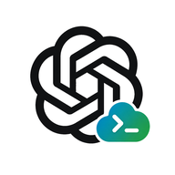
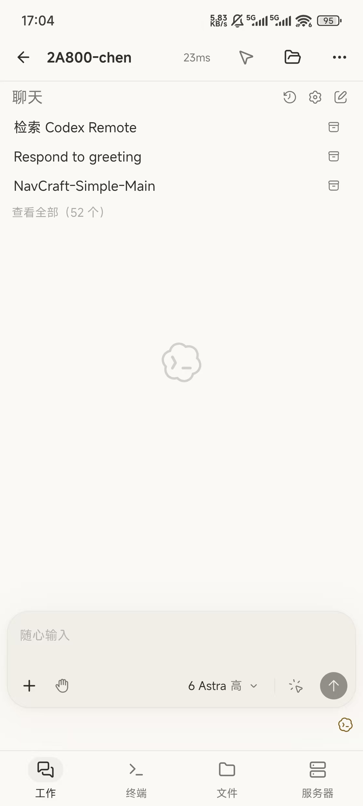
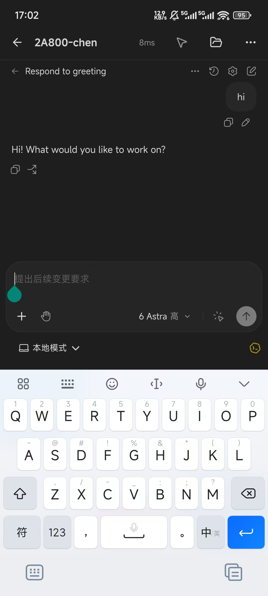
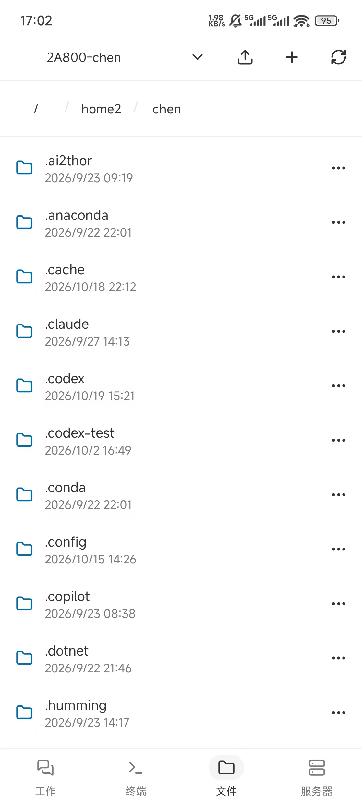

<p align="center">
  
</p>

<h1 align="center">Codex Remote</h1>

把官方 Codex VS Code 插件带到 Android。**直接复用官方聊天界面和 `extension.js`，不重写会话、模型选择、审批或多端协调逻辑。**

我们负责手机宿主、连接和传输，聊天行为由官方插件与 Codex App Server 处理。前端和扩展来自同一份官方插件包，文件保持原样，可独立更新；无需为每次界面变化重新实现一套聊天客户端。

<p align="center">
  <a href="https://github.com/chensunlai/codex-remote/releases/latest/download/codex-remote-android.apk"><strong>下载 Android APK</strong></a> ·
  <a href="https://github.com/chensunlai/codex-remote/releases">版本发布</a> ·
  <a href="docs/usage.md">使用与维护</a> ·
  <a href="docs/development.md">开发与构建</a>
</p>

<p align="center">
  <a href="docs/assets/screenshots/home-anthropic.jpg"></a>
  <a href="docs/assets/screenshots/chat-dark.jpg"></a>
  <a href="docs/assets/screenshots/files-light.jpg"></a>
</p>

## 架构



| 组件 | 部署位置与职责 |
| --- | --- |
| App | 手机端；显示官方界面，补充附件选择、文件预览、鼠标模式等能力 |
| Gateway | 手机和 Agent 都能访问的服务器；默认端口 `6767`，不解释官方聊天消息 |
| Agent | 已安装并登录 Codex CLI 的服务器；运行官方扩展宿主，连接本机 App Server |

Gateway 和 Agent 可以同机部署。Agent 主动向 Gateway 建立连接，无需单独开放入站端口；一个 Gateway 可以接入多个 Agent。**App 和 Agent 使用同一个 Gateway 访问令牌，才能看到对应服务器。**

宿主实现插件所需的公开 VS Code API，不读取前端私有导出，不自行解析 Codex 会话文件。主题与触屏适配由宿主处理；当前不提供代码编辑、编辑器上下文、代码跳转或登录回调，也不支持 WSL。官方插件更新仍可能带来新的宿主能力要求。

## 快速使用

准备好以下环境：

- **Gateway / Linux Agent**：glibc Linux，支持 x86_64 和 arm64。
- **Agent**：运行用户已安装并登录 Codex CLI，能够执行 `codex`。安装包自带 Node.js 和扩展宿主，无需另装 Node.js。
- **Windows Agent（分支测试版）**：提供原生 x64 托盘应用，下载 ZIP 解压启动；与 Linux 共用 Gateway，详见 [Windows 使用说明](docs/windows.md)。
- **App**：Android 8.0 及以上，系统 WebView 可用；默认使用 Gateway 的 **HTTPS 地址**。

### 1. Gateway

在 Gateway 服务器执行：

```bash
wget -qO- https://raw.githubusercontent.com/chensunlai/codex-remote/main/install.sh \
  | sudo bash -s -- gateway --systemd
```

默认安装到 **`/opt/codex-remote`**，创建并启动 systemd 服务。安装前需有 `curl`、`flock` 等系统工具。

查看运行状态和首次生成的管理员令牌：

```bash
sudo systemctl status codex-remote-gateway
sudo cat /opt/codex-remote/data/api-token
```

这个令牌就是 App 中的 **Gateway Key**，不是 OpenAI API Key。使用它连接 App 后，可以在手机上创建和管理令牌；新建令牌的明文只显示一次。

也可以在服务器打开交互式管理界面：

```bash
sudo /opt/codex-remote/codex-remote-gateway
```

安装脚本按参数安装，交互界面由程序提供。不使用 systemd 时，省略安装命令中的 `--systemd`，再执行 `sudo /opt/codex-remote/codex-remote-gateway start` 启动服务。

### 2. Agent

在运行 Codex 的服务器上，**以已登录 Codex 的用户**执行：

```bash
wget -qO- https://raw.githubusercontent.com/chensunlai/codex-remote/main/install.sh \
  | bash -s -- agent

~/.local/codex-remote/codex-remote-agent
```

默认安装到 **`~/.local/codex-remote`**。首次启动按提示填写：

| 配置项 | 示例或说明 |
| --- | --- |
| Gateway 地址 | `https://codex.example.com` |
| 服务名称 | App 中显示的名称，如 `开发服务器` |
| 访问令牌 | 与 App 使用的 Gateway Key 一致 |
| Codex 路径 | 默认 `codex`，也可指定可执行文件的绝对路径 |

配置保存在安装目录的 `agent.json`，后续启动直接使用；需要重新配置时加 `--configure`。

安装器不为 Agent 创建后台服务。完成配置并退出前台进程后，可用 tmux 托管：

```bash
tmux new -s codex-remote-agent "$HOME/.local/codex-remote/codex-remote-agent"
```

按 `Ctrl+B`，再按 `D` 离开；`tmux attach -t codex-remote-agent` 返回。不要同时运行同一配置的多个 Agent；tmux 不会随服务器重启自动恢复。

### 3. App

安装 [Android APK](https://github.com/chensunlai/codex-remote/releases/latest/download/codex-remote-android.apk)，然后：

1. 填写 Gateway HTTPS 地址和同一访问令牌。
2. 在“服务器”页面选择在线 Agent。
3. 点击 **“检查并下载官方前端”**，等待插件下载与初始化完成。
4. 用右上角文件夹按钮选择工作目录，再打开或新建会话。

工作目录按服务器保存，默认是 Agent 用户的主目录。官方插件由 Agent 从 Marketplace 下载，手机加载同一版本的 WebView 资源。

> **安装到其他目录或升级旧安装：** 安装命令添加 `--install-dir /原安装目录`，配置和数据会保留；Agent 更新后需自行重启。手动部署 Agent 时，二进制和 `runtime/` 必须配套更新。详见[更新说明](docs/usage.md#更新)。

使用 Sakura FRP 部署内外网访问，可参考 [Codex Remote 部署 Skill](skills/codex-remote-sakurafrp/SKILL.md)，包含隧道、HTTPS、systemd 与 App 多入口配置。

## 实验性功能

在 **App 设置 → 网关连接 → 实验性功能** 中按需开启，默认关闭：

- **允许 HTTP 网关**：适合手机通过可信局域网 IP 直连 Gateway，无需为内网地址配置 HTTPS。HTTP 会明文传输令牌和会话，仅用于可信网络。
- **多个网关入口**：适合 Gateway 部署在内网、同时通过穿透或域名提供公网访问的场景。将内网地址排在前面、公网地址作为兜底，可减少延迟和穿透流量；连接、网络变化或重连时按顺序选择，稳定连接不主动切换。内网地址使用 HTTP 时，还需开启上面的选项。

具体配置见[网关连接状态与实验性入口](docs/usage.md#网关连接状态与实验性入口)。
