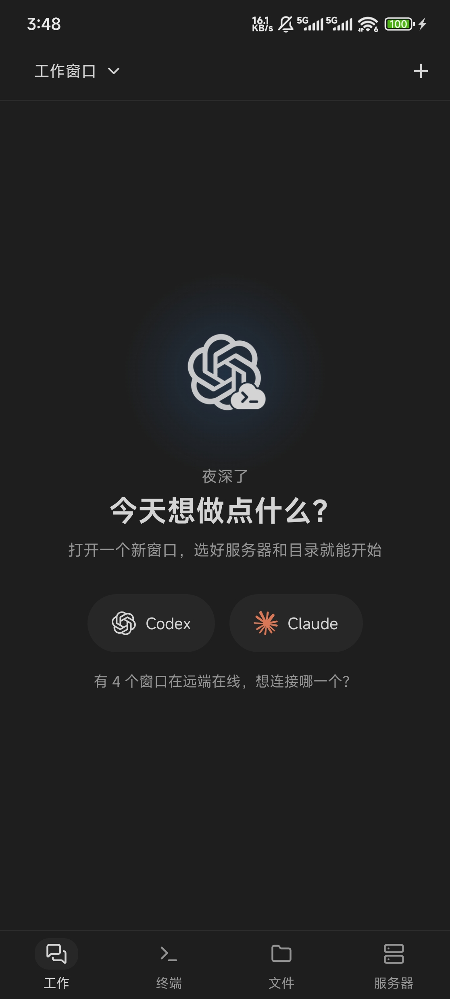
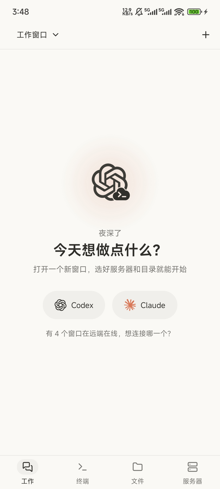
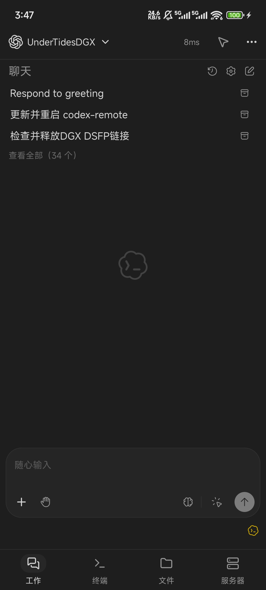
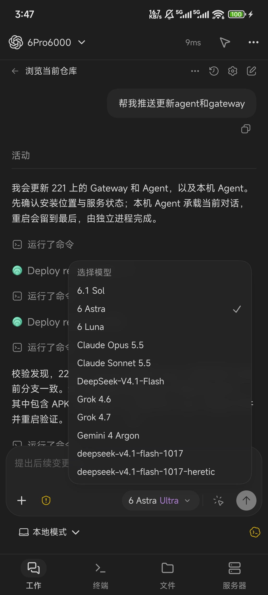
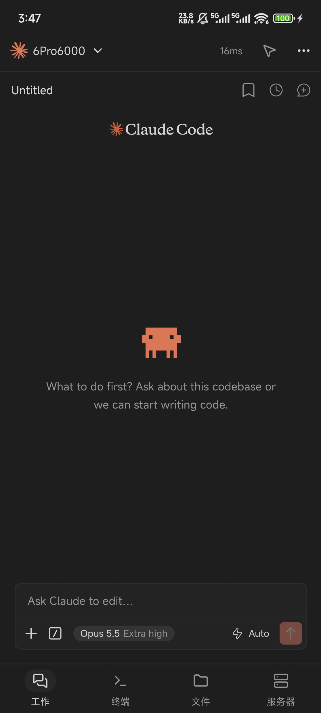
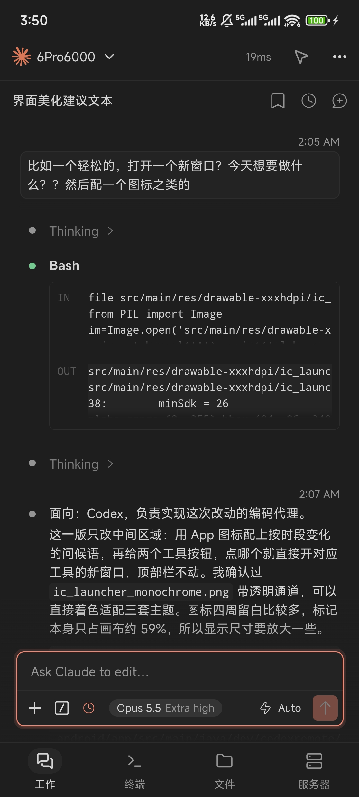

<p align="center">
  
</p>

<h1 align="center">Codex Remote</h1>

在 Android 上使用官方 Codex 与 Claude Code VS Code 插件。**直接运行官方 `extension.js` 并加载官方聊天界面，不重写会话、模型选择、审批或多端协调逻辑。**

**拥有与官方几乎完全一致的丝滑使用体验，包括使用中转、可选模型配置、审批等等功能**

**特性：窗口化管理、多远程主机、单主机多开窗口，无需重连快速切换窗口，手机退出后任务驻留**

VS Code 插件本身由扩展宿主中的 `extension.js` 与 WebView 前端两部分组成，二者仅通过消息通信。Codex Remote 在服务器上提供实现 VS Code API 的扩展宿主并加载官方 `extension.js`，手机端 WebView 加载同一插件包中的官方前端，项目本身只负责宿主、连接与传输。插件文件保持原样，官方更新后更换插件版本即可同步界面与功能。

<p align="center">
  <a href="https://github.com/chensunlai/codex-remote/releases/latest/download/codex-remote-android.apk"><strong>下载 Android APK</strong></a> ·
  <a href="https://github.com/chensunlai/codex-remote/releases">版本发布</a> ·
  <a href="docs/usage.md">使用与维护</a> ·
  <a href="docs/development.md">开发与构建</a>
</p>

<p align="center">
  <a href="docs/assets/screenshots/welcome-dark.jpg"></a>
  <a href="docs/assets/screenshots/welcome-light.jpg"></a>
</p>

## 主要功能

- 会话与历史、模型切换、命令与文件改动审批、设置均由官方插件处理；服务器上 Codex 与 Claude 的配置（包括中转与第三方 provider）照常生效。
- 支持多个工作窗口，Codex 与 Claude Code 可同时打开多个项目，每个窗口使用独立的扩展宿主与后端；最近访问的窗口驻留内存，切换时无需重新加载。
- 任务在服务器上执行，手机锁屏、切换到后台或短暂断线不会中断已接受的任务。
- 支持手机图片与文件作为聊天附件，远端文件浏览、预览与下载，以及 Linux 服务器终端。
- 鼠标模式使依赖悬停的官方控件可在触屏上操作；提供黑色、白色与 Anthropic 暖色主题。
- Agent 主动连接 Gateway，服务器无需开放入站端口；令牌、服务状态以及 Gateway、Agent 与 Codex CLI 的更新均可在 App 中管理。

<p align="center">
  <a href="docs/assets/screenshots/codex-home.jpg"></a>
  <a href="docs/assets/screenshots/codex-models.jpg"></a>
  <a href="docs/assets/screenshots/claude-home.jpg"></a>
  <a href="docs/assets/screenshots/claude-chat.jpg"></a>
</p>

## 架构


| 组件 | 部署位置与职责 |
| --- | --- |
| App | 手机端；显示官方前端，提供工作窗口、附件选择、文件预览、终端与鼠标模式 |
| Gateway | 手机与 Agent 均可访问的服务器；默认端口 `6767`，负责令牌鉴权与路由，不解析聊天内容 |
| Agent | 运行 Codex 或 Claude Code 的服务器；从 VS Code Marketplace 下载官方插件，为每个工作窗口运行扩展宿主及其后端 |

Gateway 与 Agent 可以同机部署。Agent 主动向 Gateway 建立连接，一个 Gateway 可以接入多个 Agent。**App 与 Agent 使用同一个 Gateway 访问令牌时，App 中才会显示对应服务器。**

宿主仅实现插件所需的公开 VS Code API，不读取前端私有导出，也不解析会话文件。接入新的 Coding Agent 时，登记其插件包与侧边栏视图并补充所需的宿主 API 即可，Claude Code 即按此方式接入。当前不提供代码编辑、编辑器上下文、代码跳转与登录回调，也不支持 WSL。

## 快速开始

运行环境：

- **Gateway / Linux Agent**：glibc Linux，支持 x86_64 与 arm64。
- **Agent**：运行用户已安装并登录 Codex CLI；使用 Claude Code 时，需在同一用户下完成 Claude 认证。安装包自带 Node.js 与扩展宿主。
- **App**：Android 8.0 及以上，系统 WebView 可用。

已有 Gateway 与访问令牌时，可直接从第 2 步开始。

### 1. 部署 Gateway

在 Gateway 服务器执行，该服务器需要 Agent 侧与 APP 侧都能访问，可以是公网服务器，也可以是内网服务器配合穿透使用：

```bash
wget -qO- https://raw.githubusercontent.com/chensunlai/codex-remote/main/install.sh \
  | sudo bash -s -- gateway --systemd
```

程序默认安装到 **`/opt/codex-remote`**，并创建、启动 systemd 服务；安装前需具备 `curl`、`flock` 等系统工具。App 默认通过 HTTPS 访问 Gateway，通常需要在 Gateway 前配置 nginx 等反向代理。

查看运行状态与首次生成的管理员令牌：

```bash
sudo systemctl status codex-remote-gateway
sudo cat /opt/codex-remote/data/api-token
```

该令牌即 App 中的 **Gateway Key**，并非 OpenAI API Key。使用该令牌连接 App 后，可在手机上创建与管理其他令牌；也可在服务器上执行 `sudo /opt/codex-remote/codex-remote-gateway` 打开交互式管理界面。不使用 systemd 时，省略安装命令中的 `--systemd`，再执行 `sudo /opt/codex-remote/codex-remote-gateway start` 启动服务。

### 2. 部署 Agent

#### Linux

以已登录 Codex 的用户执行：

```bash
wget -qO- https://raw.githubusercontent.com/chensunlai/codex-remote/main/install.sh \
  | bash -s -- agent
```

程序默认安装到 **`~/.local/codex-remote`**。安装时填写 Gateway 地址、服务名称、访问令牌（与 App 使用的 Gateway Key 一致）及 Codex 路径，配置保存在安装目录的 `agent.json`。

安装器默认配置并启动**当前用户的 systemd 服务**，启用异常重启、开机自启和退出登录后继续运行，无需再开终端或 tmux。启用 linger 若需要管理员授权，按安装器提示执行 `sudo loginctl enable-linger "$USER"` 后重新安装；Agent 本身始终使用原用户运行。

```bash
systemctl --user status codex-remote-agent
journalctl --user -u codex-remote-agent -f
```

已有 tmux／手动运行的 Agent，应先停止原进程，再以原用户、原安装目录重新安装一次，避免同一配置重复运行。仅下载、不配置服务时添加 `--no-service`，随后自行运行 Agent。

Windows 与 macOS Agent 见下方[实验性功能](#实验性功能)。

### 3. 安装 Android App

安装 [Android APK](https://github.com/chensunlai/codex-remote/releases/latest/download/codex-remote-android.apk) 后：

1. 填写 Gateway 的 HTTPS 地址与同一访问令牌。
2. 在工作页新建窗口，选择在线服务器、工具（Codex 或 Claude Code）与工作目录。
3. 首次使用某个工具时，点击 **“检查并下载 Codex”** 或 **“检查并下载 Claude Code”**，等待官方插件下载与初始化完成。

官方插件由 Agent 从 Marketplace 下载，手机加载同一版本的前端资源。工作目录默认为 Agent 用户的主目录。

**App 更新**在“App 设置 → 应用更新”；**Agent 更新**在底部“服务器”页对应服务器下。托管安装支持检查更新并点击“更新 Agent”，确认后下载、校验并重启；更新会影响该服务器的所有窗口，请在任务结束后操作。

> **自定义安装目录或升级旧安装：** 在安装命令中添加 `--install-dir /原安装目录`，配置与数据会保留；默认托管的 Agent 会自动重启。手动部署 Agent 时，二进制与 `runtime/` 必须配套更新。详见[更新说明](docs/usage.md#更新)。

使用 Sakura FRP 实现内外网访问时，可参考 [Codex Remote 部署 Skill](skills/codex-remote-sakurafrp/SKILL.md)，其中包含隧道、HTTPS、systemd 与 App 多入口配置。

## 实验性功能

以下选项位于 **App 设置 → 网关连接 → 实验性功能**，默认关闭：

- **允许 HTTP 网关**：用于手机通过可信局域网地址直连 Gateway。HTTP 明文传输令牌与会话，仅适用于可信网络。
- **多个网关入口**：为同一 Gateway 配置内网、公网等多个地址，连接时按顺序选择，以降低延迟与穿透流量。

具体配置见[网关连接状态与实验性入口](docs/usage.md#网关连接状态与实验性入口)。

### Windows Agent（实验性）

Windows Agent 支持原生 Windows x64，相关功能仍在完善中。先安装并登录 Codex CLI，再从[版本发布](https://github.com/chensunlai/codex-remote/releases)下载 `codex-remote-windows-x64-setup.exe` 或 `codex-remote-windows-x64.zip` 便携包；安装包自带 Node.js 与 .NET。

首次运行时填写 Gateway 地址、访问令牌与服务器名称，并选择自动检测到的 Codex 或手动指定其启动文件。程序关闭窗口后驻留系统托盘，可在托盘中启动、停止、修改配置、设置登录后自动启动及检查更新；配置、日志与插件缓存保存在安装目录的 `data` 文件夹。Windows 当前支持聊天与文件操作，不提供终端与 Claude Code，详见 [Windows 使用说明](docs/windows.md)。

### macOS Agent（实验性）

支持 Apple Silicon（arm64）与 Intel（x64），用法与 Linux 命令行 Agent 一致，不提供菜单栏程序。Gateway 继续部署在 Linux 上。

```bash
curl -fsSL https://raw.githubusercontent.com/chensunlai/codex-remote/main/install.sh \
  | bash -s -- agent
```

安装器按架构下载 Agent 与配套 Node.js，默认放在 `~/.local/codex-remote`；安装时填写 Gateway、令牌及服务名称。Codex 从当前 PATH 查找，也可在配置时指定完整路径；使用前完成所选工具的登录或认证。支持 Codex、Claude、文件操作与终端；Claude 使用官方插件自带程序，手机端需更新到支持 macOS 工具能力的版本。

默认由当前用户的 **launchd LaunchAgent** 托管，登录后自启、异常退出后重启；需在该用户已登录的桌面会话中安装，退出登录后不会继续运行。不提供菜单栏程序。添加 `--no-service` 可保留手动运行方式。安装需要包含 macOS 产物的版本，平台仍属实验性，真实桌面会话与睡眠恢复需进一步验证。

## 致谢

感谢 [LINUX DO](https://linux.do/) 社区提供的交流平台与反馈。

## 声明

本项目为第三方项目，与 OpenAI、Anthropic 无隶属关系。Codex、Claude Code 及相关商标归各自所有者所有。
